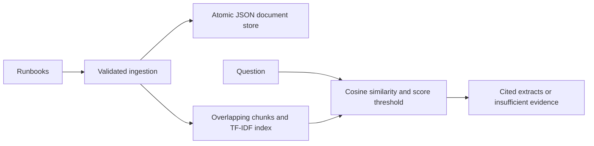

# RAG Incident Assistant

Retrieve relevant runbook and incident evidence through a FastAPI service using
scikit-learn TF-IDF and cosine similarity. This is the **retrieval and extractive
answering stage of a RAG workflow**: no LLM, embeddings service, or vector database
is used. Operational suggestions cite their source chunks instead of returning
an unrelated hardcoded checklist.

## Architecture



## Run locally

Use Python 3.14. From this repository:

```sh
python -m venv .venv
# Windows PowerShell: .venv\Scripts\Activate.ps1
# macOS/Linux: source .venv/bin/activate
python -m pip install -r requirements-dev.lock
uvicorn app.main:app --reload --no-access-log
```

Open http://127.0.0.1:8000/docs. Use synthetic or approved documents only.

```sh
curl -X POST http://127.0.0.1:8000/ingest -H "Content-Type: application/json" --data-binary @sample_docs.json
curl -X POST http://127.0.0.1:8000/ask -H "Content-Type: application/json" -d '{"question":"database connection pool exhaustion","top_k":3,"min_score":0.1}'
```

In Windows PowerShell, use `curl.exe` for these commands.

| Endpoint | Behavior |
|---|---|
| `GET /health` | Process liveness |
| `GET /ready` | 503 until a searchable corpus is available |
| `POST /ingest` | Validate and atomically replace the whole corpus |
| `POST /ask` | Ranked extracts, source IDs, similarity scores, and abstention |

The index is rebuilt from JSON on restart. Ingestion accepts 1–200 documents,
unique document IDs, at most 20,000 characters per document, and up to 2,000 chunks.
Chunks contain up to 120 words with 20-word overlap. Questions are limited to
2,000 characters and `top_k` to 1–10. HTTP bodies are limited to 1 MiB.
Similarity scores rank lexical matches; they are not probabilities or verified
root-cause confidence. Zero and weak matches are excluded.

## Configuration and deployment

| Variable | Default | Purpose |
|---|---|---|
| `ENVIRONMENT` | `development` | Production requires an API key of at least 32 characters |
| `API_KEY` | unset | Protects ingestion and queries through `X-API-Key` |
| `RAG_DATA_PATH` | `data/documents.json` | Private JSON document store |

Configure variables through the shell or your secret manager; `.env` is an
example only and is not automatically loaded. TLS, rate limiting, request
timeouts, and network access restrictions belong at the ingress boundary.
The service emits request IDs, status, and latency through the standard Python
logger `service.requests`; configure an INFO logging handler in your deployment.
It does not log questions, documents, API keys, or response bodies.

```sh
docker build -t rag-incident-assistant .
docker volume create rag-data
docker run --rm -p 127.0.0.1:8000:8000 -v rag-data:/service/data rag-incident-assistant
```

For production, also pass `ENVIRONMENT=production` and an API key from a secret
store. The container runs as a non-root user. Use **one worker and one replica**
per document store: file replacement is atomic and threads are synchronized,
but separate processes do not share the in-memory index. JSON is stored as
plaintext; use encrypted storage with restrictive access. Do not ingest secrets.

## Verification

```sh
python -m unittest discover -s tests -v
python scripts/evaluate.py
```

Tests cover ranking, citations, abstention, restart persistence, failed-ingest
atomicity, validation, and authentication. The evaluation script reports Recall@1
and MRR on the small synthetic fixture; it is not a production benchmark.
CI runs tests, dependency auditing, and a container build. There are no claims of
measured production MTTR improvements or answer accuracy.

## Scope

There is no model training, generative answer synthesis, multi-tenant isolation,
distributed index, or cross-service alert processor. Alert reduction is maintained
separately in [alert-noise-reduction](https://github.com/praveen-ai-platform/alert-noise-reduction).
