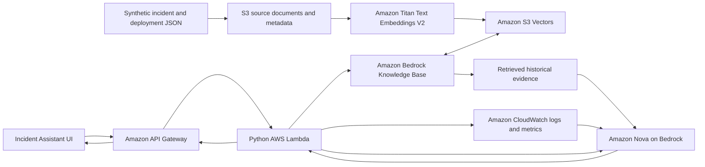

# RAG Incident Assistant (PoC)

A personal proof of concept for investigating incidents using historical incident
and deployment knowledge. The AWS demo architecture connects **API Gateway,
Lambda, Amazon Bedrock Knowledge Bases, Titan embeddings, Amazon S3 Vectors,
Amazon Nova, and optional CloudWatch context**. A small UI and synthetic JSON
records demonstrate the incident-investigation experience.

## Demo architecture



The Knowledge Base manages chunking, Titan embedding generation, and the vector
index. Lambda calls Bedrock `Retrieve`, optionally collects configured CloudWatch
signals, and calls Nova through `Converse`. This keeps retrieval evidence and live
context available in one generation request.

**JSON records are source data.** The seed script converts them into S3 text
objects with metadata sidecars. Bedrock generates embeddings and stores the
vectors in S3 Vectors. Raw JSON files are not inserted directly into a vector
index. The bundled incident and deployment records are synthetic.

## Intended operational workflow

The broader idea is: a new ServiceNow incident initiates an investigation, past
incidents and Jenkins deployment records provide historical context, CloudWatch
provides live signals, and the resulting potential root cause and resolution are
shared with the operations team's Microsoft Teams channel.

**The demo is scoped to the AWS architecture above.** ServiceNow event delivery,
automated Jenkins history collection, and Teams channel publishing are intended
integrations and are not connected by this repository. The demo uses synthetic
JSON records to represent the historical inputs. No notification or remediation
is performed automatically.

See [Architecture and workflow](docs/architecture.md) for the demo boundaries,
sequence, intended integration points, and security considerations.

## What the PoC implements

- An incident-investigation UI and FastAPI development server.
- An IAM-protected API Gateway HTTP API and native Python Lambda entry point.
- Bedrock Knowledge Base retrieval backed by S3 Vectors and Titan embeddings.
- Nova generation of a **potential root cause**, **potential resolution**, and
  **verification steps**, with references to retrieved evidence.
- Optional read-only context from configured CloudWatch log groups and a metric.
- Synthetic S3 source ingestion and a managed Knowledge Base ingestion job.
- Terraform configuration for the AWS demo resources and scoped execution roles.
- An offline retrieval mode for trying the UI without AWS access or model calls.

These are hypotheses for a responder to verify, not confirmed root-cause
findings. Similar historical incidents and recent deployments provide evidence;
temporal proximity alone does not establish causation.

## Try the UI without AWS

Use Python 3.14:

```sh
python -m venv .venv
# Windows PowerShell: .venv\Scripts\Activate.ps1
# macOS/Linux: source .venv/bin/activate
python -m pip install -r requirements-dev.lock
uvicorn app.main:app --reload --no-access-log
```

Open http://127.0.0.1:8000, select **Load synthetic example history**, and investigate
a checkout or billing incident. API documentation is at `/docs`.

`RAG_BACKEND=demo` is the default. It uses local TF-IDF retrieval and returns
sample evidence extracts; it does not simulate a real model response. The UI
labels this mode. The original four-runbook fixture remains in `sample_docs.json`
for the lexical retrieval evaluation script.

## Use the AWS architecture

Use your own sandbox account and a region supporting the selected Bedrock models,
Knowledge Bases, and S3 Vectors. Model access, IAM permissions, quotas, and regional
availability must be configured in that account. AWS usage incurs charges.

1. Build the Linux-compatible Lambda package:

   ```sh
   python scripts/package_lambda.py
   ```

2. Initialize and validate Terraform, then review the plan:

   ```sh
   terraform -chdir=terraform init
   terraform -chdir=terraform validate
   terraform -chdir=terraform plan
   ```

   Apply a reviewed plan yourself when ready. CI never deploys AWS resources.
   Terraform creates the S3 source bucket, S3 vector bucket/index, Knowledge Base,
   source connector, Lambda, IAM roles, and IAM-authorized API Gateway routes.
   Data resources are not configured for forced deletion. The native Lambda uses
   Python 3.13 and excludes the UI/scikit-learn dependencies from its ZIP.

3. Set environment variables from the Terraform outputs:

   ```text
   AWS_REGION=us-east-1
   BEDROCK_KNOWLEDGE_BASE_ID=<knowledge_base_id>
   BEDROCK_DATA_SOURCE_ID=<data_source_id>
   RAG_SOURCE_BUCKET=<source_bucket>
   BEDROCK_GENERATION_MODEL_ID=amazon.nova-lite-v1:0
   ```

   `.env.example` lists settings but is not automatically loaded. Set variables
   in your shell or deployment configuration; do not commit credentials.

4. Upload the synthetic incident and deployment records and start indexing:

   ```sh
   python scripts/seed_knowledge_base.py
   ```

   Check the returned job ID in Bedrock and wait for `COMPLETE` before querying.
   Ingestion upserts records by stable IDs; it does not erase unrelated history.
   Upload permissions and `bedrock:StartIngestionJob` belong to the separate seeding
   identity; the query Lambda has no ingestion permissions.

5. Set `RAG_BACKEND=aws` and launch the UI server again to query the real Bedrock
   backend using your local AWS identity. Alternatively call the deployed API
   Gateway endpoint with AWS Signature Version 4 authentication:

   ```sh
   python scripts/invoke_gateway.py https://YOUR_API_ID.execute-api.us-east-1.amazonaws.com/ask "Checkout 5xx errors after a deployment"
   ```

   The local UI sends requests to its FastAPI backend. The cloud API uses Lambda;
   it does not host the UI assets. A directly hosted browser UI would need an
   authenticated SigV4-capable client or another reviewed authorization layer.

## Configuration

| Variable | Purpose |
|---|---|
| `RAG_BACKEND` | `demo` for local extracts; `aws` for Knowledge Base + Nova |
| `API_KEY` | Optional local API protection through `X-API-Key` |
| `ENVIRONMENT` | Local production mode requires an API key of at least 32 characters |
| `RAG_DATA_PATH` | Offline JSON document store; defaults to `data/documents.json` |
| `AWS_REGION` | AWS region; defaults to `us-east-1` |
| `BEDROCK_KNOWLEDGE_BASE_ID` | Knowledge Base configured with Titan and S3 Vectors |
| `BEDROCK_GENERATION_MODEL_ID` | Nova model ID; defaults to `amazon.nova-lite-v1:0` |
| `RAG_SOURCE_BUCKET` | S3 source bucket used by the seed script |
| `BEDROCK_DATA_SOURCE_ID` | S3 data source used by the seed script |
| `CLOUDWATCH_LOG_GROUPS` | Optional comma-separated allowlist, up to three groups |
| `CLOUDWATCH_METRIC_NAMESPACE` | Optional metric namespace |
| `CLOUDWATCH_METRIC_NAME` | Optional metric name |
| `CLOUDWATCH_METRIC_DIMENSIONS` | JSON list of `Name`/`Value` dimension objects |

The Terraform model setting expects a regional Nova foundation model. If using a
cross-region inference profile, update the model ID and IAM policy to permit the
profile and its destination foundation models.

## API

| Endpoint | Local FastAPI | API Gateway / Lambda |
|---|---|---|
| `GET /` | Demo UI | UI is hosted separately |
| `GET /health` | Liveness and backend mode | Not exposed |
| `GET /ready` | Local index readiness, or AWS configuration status | Not exposed |
| `GET /demo-data` | Synthetic sample records | Not exposed |
| `POST /ingest` | Offline corpus replacement | Use the seed script for AWS ingestion |
| `POST /ask` | Investigate incident text | IAM-authorized investigation |
| `POST /incidents` | Same normalized investigation request | Future event-adapter entry point |

Example investigation request:

```json
{
  "question": "Checkout 5xx errors increased after deployment. What should we investigate?",
  "service": "checkout",
  "top_k": 3,
  "min_score": 0.1,
  "include_live_context": false
}
```

`service` is an optional AWS metadata filter. The deployed endpoint accepts this
normalized request; it is not a native ServiceNow webhook adapter. AWS answers
include potential causes, potential resolutions, verification steps, cited source
IDs, evidence excerpts, telemetry context, and missing-context warnings. Weak
retrieval results return `insufficient_evidence` without invoking Nova.

## Validation and limits

```sh
python -m unittest discover -s tests -v
python scripts/evaluate.py
```

Tests cover offline ranking and persistence, AWS retrieval request contracts,
generation/citation validation, missing telemetry, S3 ingestion, Lambda
validation/authentication, and UI endpoints. AWS tests use stubs or mocks; no
live model invocation or cloud deployment is claimed. `scripts/evaluate.py`
measures only the offline four-runbook fixture, not semantic retrieval or Nova
accuracy. CI also audits dependencies, builds the container and Lambda package,
and validates Terraform.

The synchronous HTTP API has a 30-second integration timeout. Sequential
retrieval, optional telemetry, and generation may exceed that limit even though
the Lambda timeout is longer. Keep the PoC context small and measure latency;
a continuous operational integration should use an asynchronous worker and
status/callback delivery. There is no production throughput or RCA-accuracy claim.

Input bodies are capped at 1 MiB; questions at 2,000 characters; retrieval at ten
results. CloudWatch context is limited to the previous 15 minutes, at most three
log groups, twenty events per group, and one configured metric. Logs and source
text are sent to Bedrock in AWS mode; use only synthetic or approved sandbox data.
Do not load employer documents, production logs, credentials, or customer data.

Offline persistence is plaintext JSON with a single-worker/replica limit. Treat
model outputs as untrusted text. The server rejects unsupported citations, and
the UI renders results with `textContent`. No operational actions are executed.

## References

- [Bedrock Knowledge Bases with S3 Vectors](https://docs.aws.amazon.com/AmazonS3/latest/userguide/s3-vectors-query.html)
- [Titan Text Embeddings models](https://docs.aws.amazon.com/bedrock/latest/userguide/titan-embedding-models.html)
- [Bedrock Knowledge Base permissions](https://docs.aws.amazon.com/bedrock/latest/userguide/kb-permissions.html)
- [Amazon Nova model specifications](https://docs.aws.amazon.com/nova/latest/userguide/what-is-nova.html)
