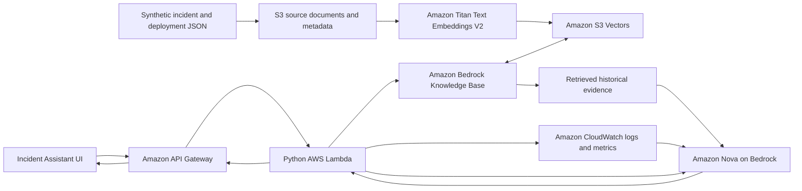

# RAG Incident Assistant (PoC)

A personal proof of concept demonstrated live on AWS to explore how historical
incident knowledge and deployment history can support incident investigation.
The demonstration used a UI and sample JSON records, with API Gateway, Lambda,
Amazon Bedrock, Titan embeddings, Amazon S3 Vectors, and Amazon Nova forming the
retrieval and response-generation workflow.

## Project objective

Help an operations responder investigate an incident by bringing together
relevant historical context and available monitoring signals. The assistant
presents a potential root cause, a potential resolution, and supporting evidence
for the responder to review.

## Demonstrated architecture

## How the solution works

1. **Historical knowledge:** Sample JSON records represent past incidents and
   Jenkins deployment history. These records provide the demonstration's source
   material.
2. **Source storage:** The records are prepared as documents and metadata in S3.
3. **Embedding and indexing:** Amazon Bedrock Knowledge Bases chunks the source
   documents, generates embeddings using Amazon Titan, and stores the vectors
   in Amazon S3 Vectors.
4. **Incident submission:** The UI submits an incident description through API
   Gateway to a Python Lambda function.
5. **Semantic retrieval:** The Knowledge Base retrieves relevant incident and
   deployment evidence from the vector index.
6. **Monitoring context:** Configured CloudWatch logs and metrics can supplement
   the historical evidence with recent operational signals.
7. **Response generation:** Amazon Nova analyzes the incident and retrieved
   context to propose a potential root cause, resolution, and verification steps.
   The response is presented through the UI with supporting source references.

S3 stores the source documents; S3 Vectors stores their embeddings and retrieval
metadata. The JSON records serve as the source material for this process.

## Demonstration scope

The live PoC focused on the AWS architecture and the investigation experience
using sample incident and deployment records. It demonstrated how retrieval and
LLM-generated analysis can work together to support a responder's investigation.

Generated findings are potential explanations to verify. A similar past incident
or a recent deployment can inform an investigation without proving the cause of
a new incident.

## Broader operational idea

The intended end-to-end workflow extends the demonstrated architecture:

- A new **ServiceNow** incident triggers the investigation.
- Historical incidents and **Jenkins** deployment records populate the knowledge
  source through automated collection.
- **CloudWatch** supplies relevant live logs and metrics.
- The assistant shares its findings with the operations team's **Microsoft Teams**
  channel.

ServiceNow triggering, automated Jenkins collection, and Teams publishing are
intended integrations. The demonstrated PoC used the supplied AWS architecture
and sample records to represent the historical inputs.

## Technology stack

| Component | Role |
|---|---|
| Python and AWS Lambda | Incident-investigation orchestration |
| Amazon API Gateway | API entry point |
| Amazon S3 | Historical source documents and metadata |
| Amazon Titan Text Embeddings | Semantic representation of historical knowledge |
| Amazon S3 Vectors | Vector storage and similarity retrieval |
| Amazon Bedrock Knowledge Bases | Managed ingestion and retrieval |
| Amazon Nova | Potential root-cause and resolution generation |
| Amazon CloudWatch | Optional operational logs and metrics |
| UI | Incident submission and response presentation |
| Terraform | Infrastructure configuration |

## Repository references

- [Architecture and workflow](docs/architecture.md): diagrams and integration boundaries.
- [Development reference](docs/development.md): implementation setup and deployment details.
- `app/demo_records.json`: synthetic incident and deployment source records.
- `app/aws_backend.py`: Knowledge Base retrieval, CloudWatch context, and Nova generation.
- `app/lambda_handler.py`: API Gateway request handling.
- `terraform/`: AWS infrastructure configuration.

## Validation

The repository includes automated tests for retrieval, generation response
validation, source citations, ingestion, and request handling. CI checks dependency
advisories, container and Lambda packaging, and Terraform configuration. These
checks complement the live PoC demonstration; they do not establish production
accuracy or throughput.
