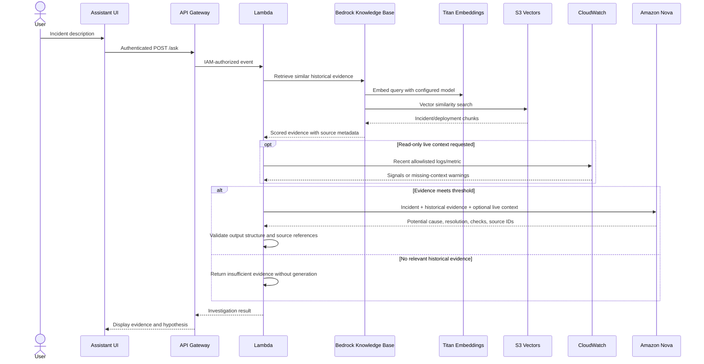
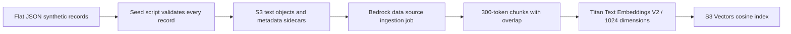
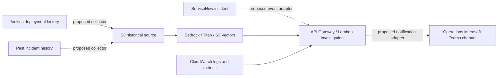

# Incident investigation architecture

The demo topology follows the supplied architecture reference: Assistant UI,
API Gateway, Lambda, Amazon Bedrock, S3 source data, Titan embeddings, a Knowledge
Base with S3 Vectors, Nova generation, and CloudWatch context. It uses synthetic
records and personal sandbox resources.

## Demo sequence

The UI-to-Gateway path represents cloud deployment. The bundled development UI
uses its same-origin FastAPI backend, which calls the same AWS orchestration in
AWS mode. It does not automatically authenticate a browser to the IAM endpoint.

## Historical source ingestion

S3 and S3 Vectors have different roles: S3 holds source documents; S3 Vectors
holds numeric embeddings and retrieval metadata. Bedrock handles ingestion and
query embeddings with the same configured model. The application does not send
flat JSON directly to `PutVectors`. Index metadata reserves Bedrock text and
metadata keys as non-filterable so they do not consume filterable metadata space.

## Intended operational integrations

Dashed arrows are intended extensions. There are no ServiceNow credentials,
Jenkins API clients, or Teams publishing code in this PoC. These connections were
not part of the demonstrated architecture. `/incidents` accepts the same
normalized request as `/ask`; an external adapter would map a real event to it.
No organizational data or integrations are required to demonstrate the UI.

## Boundaries and tradeoffs

- API Gateway enforces AWS IAM; Lambda rejects events missing the expected IAM
  request context. There is no public unauthenticated function URL.
- The Knowledge Base role can read only the source prefix, invoke Titan, and use
  the configured vector index. The query role invokes Nova and retrieves from
  the Knowledge Base; it cannot upload source records or start ingestion.
- CloudWatch reads are optional, allowlisted by configuration, and reported as
  unavailable if a read fails. Missing signals are not silently fabricated.
- Model instructions treat retrieved text and logs as untrusted evidence. Output
  must parse into the expected schema and reference known evidence IDs. These
  checks limit unsupported output but do not prove the model's reasoning correct.
- The model proposes a hypothesis and investigation steps. It never performs a
  rollback, modifies an incident, or triggers a remediation action.
- The HTTP demo is synchronous. API Gateway may time out before Lambda finishes;
  production event-driven work needs an asynchronous design and delivery retry
  strategy. Those components are intentionally outside this demonstration.
- Terraform validates resource structure locally; actual regional availability,
  model access, IAM propagation, ingestion completion, and end-to-end cloud
  behavior need verification in the user's own sandbox account.
